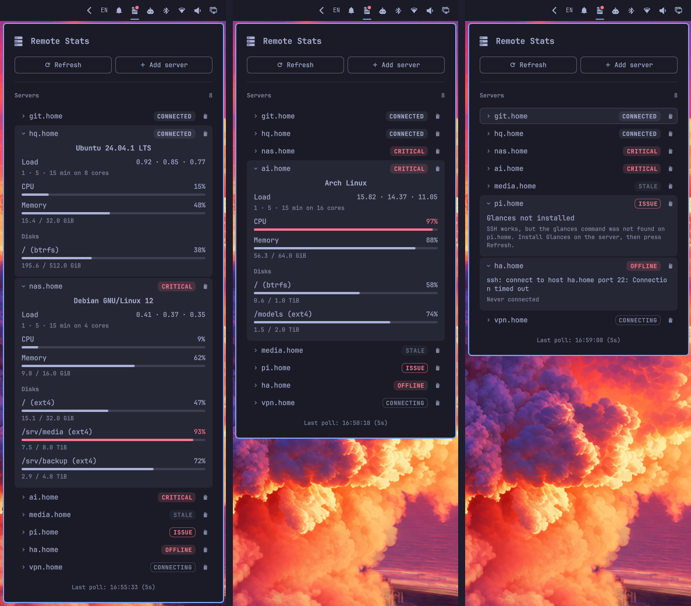

# Remote Stats

Keep an eye on your servers from the Omarchy bar: load, CPU, memory and
disks at a glance. Spot an overloaded server or a full disk before it bites.

The plugin reads the data over SSH from
[Glances](https://github.com/nicolargo/glances). Nothing else runs on the
server.



## Requirements

On your Omarchy machine (a default install has all of it):

- OpenSSH client: `ssh` and `ssh-keygen`
- `jq`
- `gum`, for the Yes/No questions of `remote-stats`

On each server:

- Linux with an SSH server that your Omarchy machine can reach
- [Glances](https://github.com/nicolargo/glances) 4 or later, tested with
  4.5.8. Versions from 3.2.7 may work, but are not tested.

## Install

```
omarchy plugin add https://github.com/pbojan/omarchy-remote-stats.git --enable
```

Omarchy asks you to confirm, then installs the plugin and turns it on.

To update the plugin later:

```
omarchy plugin update pbojan.remote-stats
```

## Helper

The `remote-stats` command sets up your servers and changes the settings.
Plugins cannot add commands to your `PATH`, so link it into `~/.local/bin`
one time:

```
ln -s ~/.config/omarchy/plugins/pbojan.remote-stats/bin/remote-stats ~/.local/bin/remote-stats
```

| Command | What it does |
| --- | --- |
| `remote-stats setup user@host[:port]` | Installs the Remote Stats key on the server |
| `remote-stats add user@host[:port] [name]` | Adds the server to the panel |
| `remote-stats remove user@host[:port]` | Removes the key from the server and the server from the panel |
| `remote-stats config` | Shows the settings |
| `remote-stats config <setting> <value>` | Changes a [setting](#change-the-settings) |

## Security

The plugin logs in with its own SSH key, the Remote Stats key
`~/.ssh/remote_stats_ed25519`. Each server lets that key run
exactly one command.

- **One command.** The key's line in the server's `authorized_keys` fixes
  the command to a Glances snapshot. Whatever the client asks for, the
  server runs that snapshot. In a test, `id`, other commands and a terminal
  request all returned only the snapshot.
- **Nothing else.** `restrict` turns off the terminal, port forwarding,
  agent forwarding and X11 forwarding for this key.
- **Read-only.** The snapshot reads load, CPU, memory and disk usage. It
  changes nothing on the server and needs no root.
- **No passwords.** The plugin never asks for or stores a password. It saves
  names, targets and the key path only.
- **Only its own key.** The plugin ignores `~/.ssh/config` and the SSH
  agent, so it never logs in with one of your keys. If a server refuses the
  Remote Stats key, the poll fails.
- **No shell on your machine.** The plugin starts `ssh` with a fixed
  argument list and refuses a target that looks like an `ssh` option.
- **Host keys.** The plugin trusts a server's host key on first contact and
  refuses to connect if the key changes later.

The trade-off: the key has no passphrase, so the plugin works right after
boot. Anyone who copies `~/.ssh/remote_stats_ed25519` can read the stats of
your servers, and nothing more. To also limit the key to your network, edit
its line on the server and put e.g. `from="192.168.2.0/24",` in front of
`restrict`.

Why it works this way: [ADR-005](docs/adr/005-dedicated-key-with-forced-command.md),
[SSH tests](docs/research/ssh-tests.md).

## Set up a server

Do these 3 steps for each server:

1. On the server, install Glances 4 or later, for example
   `sudo apt install glances`.
2. On your Omarchy machine, install the Remote Stats key on the server.
   Select **Yes** when it asks:

   ```
   remote-stats setup deploy@192.168.2.20:22
   ```

3. Add the server to the bar. In the panel, click **Add server**, or run:

   ```
   remote-stats add deploy@192.168.2.20:22 web1
   ```

<details>
<summary>1. More ways to install Glances</summary>

The plugin uses only the basic Glances plugins, so a distribution package
is enough if it is version 4 or later. Check with `glances --version`.

| Distribution | Command |
| --- | --- |
| Debian, Ubuntu | `sudo apt install glances` |
| Fedora | `sudo dnf install glances` |
| Arch | `sudo pacman -S glances` |

If the package is too old, install Glances with pip in `~/.venv`, pipx or
Homebrew. The [Glances README](https://github.com/nicolargo/glances) shows
how.

`setup` finds Glances in these places. You do not have to activate a venv.

- `PATH`
- `~/.local/bin` (pipx)
- `~/.venv/bin` (pip in a venv)
- `/home/linuxbrew/.linuxbrew/bin` (Homebrew)

If Glances is somewhere else, link it:

```
sudo ln -s /path/to/glances /usr/local/bin/glances
```

The plugin cannot use Glances in Docker or through `uvx`.

</details>

<details>
<summary>2. What <code>setup</code> does</summary>

`setup` lists its steps first. **No**, the default, changes nothing. SSH
may ask you to trust the host key, or for your password or passphrase.
This is your normal SSH login, one time.

When it works, the last line starts with `Done.`:

```
Created the Remote Stats key: /home/you/.ssh/remote_stats_ed25519
Installing the Remote Stats key on deploy@192.168.2.20:22. SSH may ask for your password.
Found Glances: /usr/bin/glances
Added the Remote Stats key to /home/deploy/.ssh/authorized_keys (backup: /home/deploy/.ssh/authorized_keys.bak-20261019-171200)
Testing the Remote Stats key...
Done. Add the server to the panel: remote-stats add deploy@192.168.2.20:22
```

The steps:

1. It makes the Remote Stats key `~/.ssh/remote_stats_ed25519`, if it
   does not exist. All servers use the same key.
2. It runs [`server/setup.sh`](server/setup.sh) on the server over SSH.
   Nothing is copied to the server. The script:
   - finds Glances and saves its path in the key line, so polls never
     search for it;
   - backs up `~/.ssh/authorized_keys`, then adds the key line. If the line
     exists, it replaces it. Other lines stay as they are.
3. It logs in with the Remote Stats key and checks that a snapshot comes
   back.

The target is `user@host:port`:

- Use a real host name or address, not an alias from `~/.ssh/config`.
  The plugin does not read that file, so `ProxyJump`, `Port` and `User`
  from it do not apply. The plugin cannot reach a server behind a jump
  host.
- `[IPv6]` addresses work.
- Without a user, the plugin uses your local user name.

You can run `setup` again at any time, for example after you move
Glances. It also closes the plugin's open connection to the server, so the
next poll uses the new Glances path.

</details>

<details>
<summary>3. Add a server: the name and Test</summary>

- In the panel, click **Add server**. Type the target, and optionally a
  name and a key. Click **Test**, then **Save**.
- In a terminal, the name is optional. Without it, the name is the host,
  `192.168.2.20` in the example. The panel does the same.

**Test** logs in anew with the key in the form and runs one poll, as the
plugin does. If one of its 5 checks fails, it shows the `ssh` error and a
hint. You can save without a passed test.

Both ways write the server to the [config file](#change-the-settings), and
the panel polls it at once.

</details>

<details>
<summary>Set up a server without the command</summary>

1. Make the Remote Stats key, one time only:

   ```
   ssh-keygen -t ed25519 -N "" -C "remote-stats@$(hostname)" -f ~/.ssh/remote_stats_ed25519
   ```

2. Find the Glances path on the server, for example `/usr/bin/glances`:

   ```
   ssh deploy@192.168.2.20 command -v glances
   ```

3. Add the key line with the forced command. Set `GLANCES` to the path from
   step 2:

   ```
   GLANCES=/usr/bin/glances
   ssh deploy@192.168.2.20 'mkdir -p ~/.ssh && chmod 700 ~/.ssh && cat >> ~/.ssh/authorized_keys && chmod 600 ~/.ssh/authorized_keys' <<EOF
   restrict,command="$GLANCES --disable-plugin all --enable-plugin system,cpu,mem,load,fs --stdout-json system,cpu,mem,load,fs" $(cat ~/.ssh/remote_stats_ed25519.pub)
   EOF
   ```

4. Test the key. The command must print one line of JSON that starts with
   `{"system":`:

   ```
   ssh -F none -i ~/.ssh/remote_stats_ed25519 -o IdentitiesOnly=yes -o IdentityAgent=none deploy@192.168.2.20
   ```

5. Add the server to the panel, as in step 3 above.

</details>

## Remove a server

To remove the server and its key line on the server:

```
remote-stats remove deploy@192.168.2.20:22
```

`remove` asks for confirmation. Then it:

1. Runs [`server/remove.sh`](server/remove.sh) on the server, which removes
   the key line after a backup. If the server does not answer, `remove`
   warns you and continues.
2. Closes the plugin's open connection to the server. Without this step,
   the connection would still work without the key line for up to 5
   minutes.
3. Removes the server from the panel.

Use the same target as for `add`, not an alias from `~/.ssh/config`. If no
server in the panel has that target, `remove` says so and changes nothing
in the panel. The Remote Stats key stays on your machine, because other
servers use it.

The remove button in the panel removes the server from the panel only. The
key line stays on the server.

## Uninstall

1. Run `remote-stats remove <target>` for each server, so no server keeps
   the Remote Stats key line.
2. If you made the `PATH` link, remove it:
   `rm ~/.local/bin/remote-stats`.
3. Remove the plugin:

   ```
   omarchy plugin remove pbojan.remote-stats
   ```

4. Optional: remove the Remote Stats key and the config file:

   ```
   rm ~/.ssh/remote_stats_ed25519 ~/.ssh/remote_stats_ed25519.pub
   rm -r ~/.config/omarchy/remote-stats
   ```

## Change the settings

| Setting | Default | Values |
| --- | --- | --- |
| `interval` | `30` | Seconds between polls, 5 or more. One snapshot takes about 2.5 s. |
| `showDisks` | `true` | `false` hides the disks in the panel. A disk at 90 % or more still marks its server Critical. |

To show the settings, or change one:

```
remote-stats config
remote-stats config interval 10
remote-stats config showDisks false
```

The panel uses a new value within about 1 s.

The command changes `~/.config/omarchy/remote-stats/config.json`. You can
also edit this file yourself:

```json
{
  "version": 1,
  "settings": { "interval": 10, "showDisks": true },
  "servers": [
    { "name": "web1", "target": "deploy@192.168.2.20:22", "key": "~/.ssh/remote_stats_ed25519" }
  ]
}
```

If the file is not valid JSON, the panel keeps showing its last good
version and says so. The panel also names each server that it skips, for
example one with a bad target or a repeated name.

## Development

Run every test with `test/run`:

- The Node tests (`test/*.test.js`) check the logic in `src/logic/`.
- `test/cli.test.sh` checks the command and the service against a throwaway
  `sshd` on `127.0.0.1:22222`. It runs `src/Service.qml` in a headless
  Quickshell. It keeps every file in a temp folder and does not touch
  `~/.ssh`.

## Documentation

- [Requirements](docs/requirements-v1.md)
- [Decisions](docs/adr/)
- Test results: [Glances](docs/research/glances-cli-tests.md),
  [SSH](docs/research/ssh-tests.md)
